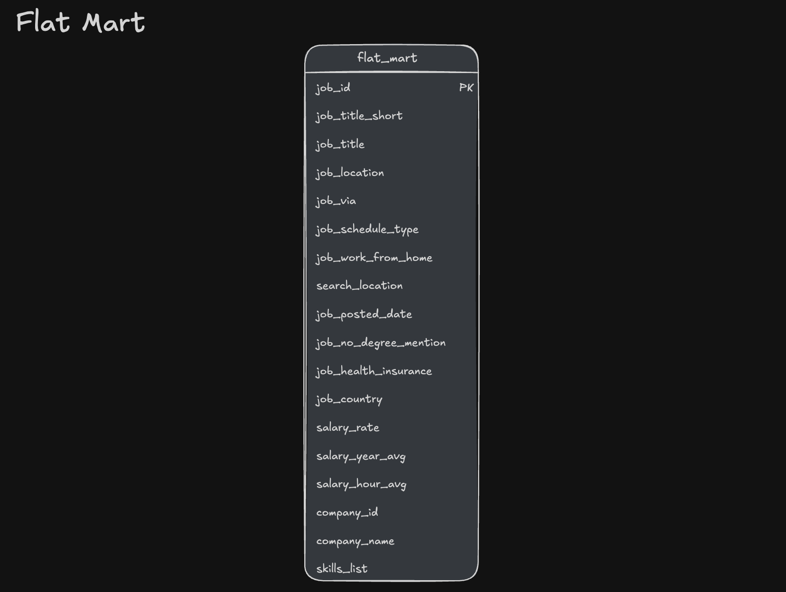
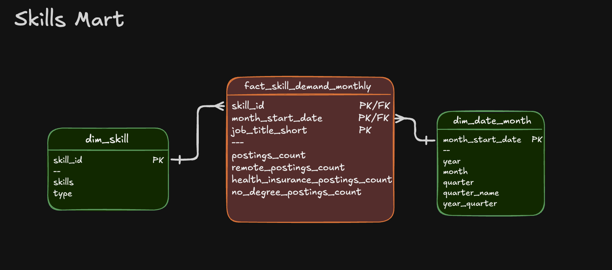
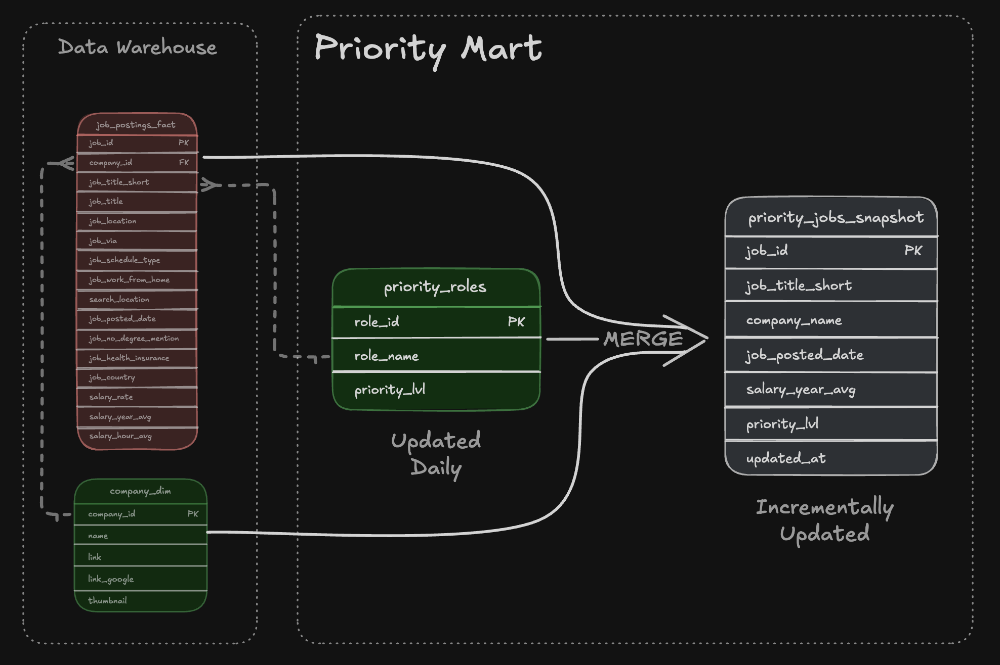

# Data Pipeline Project (DuckDB & SQL)

An end-to-end SQL data warehouse and analytics mart pipeline built with **DuckDB**, loading remote CSV datasets from Google Cloud Storage (GCS) and transforming them into star-schema tables and domain-specific data marts (`flat_mart`, `skills_mart`, `priority_mart`, and `company_mart`).

---

## 🗺️ Architecture & Visuals


### Pipeline & Data Flow


### Dimensional Schema & Data Marts






---

## 📁 Repository Structure

| File | Purpose |
| :--- | :--- |
| `1_create_tables_dw.sql` | Creates core data warehouse tables and defines explicit column types |
| `2_load_schema_dw.sql` | Loads raw CSV data from GCS into warehouse tables via `httpfs` |
| `3_create_flat_mart.sql` | Builds the denormalized `flat_mart` layer for broad analytical querying |
| `4_create_skills_mart.sql` | Builds `skills_mart` aggregated at the skill and time-bucket grain |
| `5_create_priority_mart.sql` | Builds `priority_mart` focused on high-priority job attributes and flags |
| `6_update_priority_mart.sql` | Applies incremental `MERGE` updates (`INSERT`, `UPDATE`, `DELETE`) to `priority_mart` |
| `build_dw_marts.sql` | Master orchestration script running the pipeline end-to-end |

---

## 💻 Data Engineering Skills Demonstrated

### 🔄 ETL Pipeline Development
* **Extract:** Direct remote CSV ingestion from Google Cloud Storage (GCS) utilizing DuckDB's `httpfs` extension.
* **Transform:** Standardized data normalization, explicit type casting (`CAST`, `DATE_TRUNC`), and automated quality filtering.
* **Load:** Idempotent table creation implementing `DROP TABLE IF EXISTS` patterns to guarantee clean reloads.
* **Incremental Updates:** Production-ready upsert logic via `MERGE` statements (`INSERT`, `UPDATE`, and `DELETE` in a single atomic operation).
* **Orchestration:** End-to-end automated pipeline execution driven by a master orchestration script (`build_dw_marts.sql`).

### 📐 Dimensional Modeling
* **Star Schema Architecture:** Core fact table (`job_postings_fact`) modeled alongside conformed dimension tables (`company_dim`, `skills_dim`).
* **Bridge Tables:** Many-to-many relationship resolution via dedicated bridge tables (`skills_job_dim`, `bridge_company_location`, `bridge_job_title`).
* **Fact Grain Definition:** Explicitly defined table granularities (`skill + month` and `company + title + location + month`) to prevent double-counting.
* **Additive Measures:** Engineered metrics (counts and sums) designed for safe re-aggregation across any analytical hierarchy.
* **Surrogate Key Generation:** Deterministic sequential ID assignment utilizing CTEs and self-joins (implemented in the optional `company_mart` build).

### ⚡ Advanced SQL Techniques
* **DDL & Schema Management:** Programmatic schema and table lifecycle management using `CREATE SCHEMA`, `CREATE TABLE`, and `DROP TABLE`.
* **DML & Mapping:** Explicit column-mapped ingestion from raw CSV sources via `INSERT INTO ... SELECT`.
* **Atomic `MERGE` Upserts:** Full-lifecycle incremental synchronization leveraging `WHEN MATCHED`, `WHEN NOT MATCHED`, and `WHEN NOT MATCHED BY SOURCE` clauses.
* **Common Table Expressions (CTEs):** Modular query design for multi-step transformations and boolean flag derivations.
* **Temporal & String Manipulation:** Date bucketing (`DATE_TRUNC('month')`, `EXTRACT(quarter)`) alongside text aggregation (`STRING_AGG`) and sanitization (`REPLACE`).
* **Conditional Boolean Logic:** `CASE WHEN` expressions to standardize and aggregate multi-state flags (`remote`, `health_insurance`, `no_degree`).

### 🛡️ Data Quality & Production Practices
* **Idempotency:** Engineered all SQL scripts to be safely re-runnable without side effects or duplicate records.
* **Automated Validation:** Embedded verification queries at each pipeline stage to audit row counts and data integrity.
* **Strict Type Safety:** Enforced explicit schema data types (`VARCHAR`, `INTEGER`, `DOUBLE`, `BOOLEAN`, `TIMESTAMP`) across all layers.
* **Logical Schema Isolation:** Segregated data marts into dedicated schemas (`flat_mart`, `skills_mart`, `priority_mart`, `company_mart`) for clean domain boundaries.
* **Operational Observability:** Structured script execution featuring clear status logging, progress reporting, and error handling.

---

## ▶️ How to Run

1. **Clone the repository:**
   ```bash
   git clone [https://github.com/Navigos13/Data_Pipeline_Project.git](https://github.com/Navigos13/Data_Pipeline_Project.git)
   cd Data_Pipeline_Project